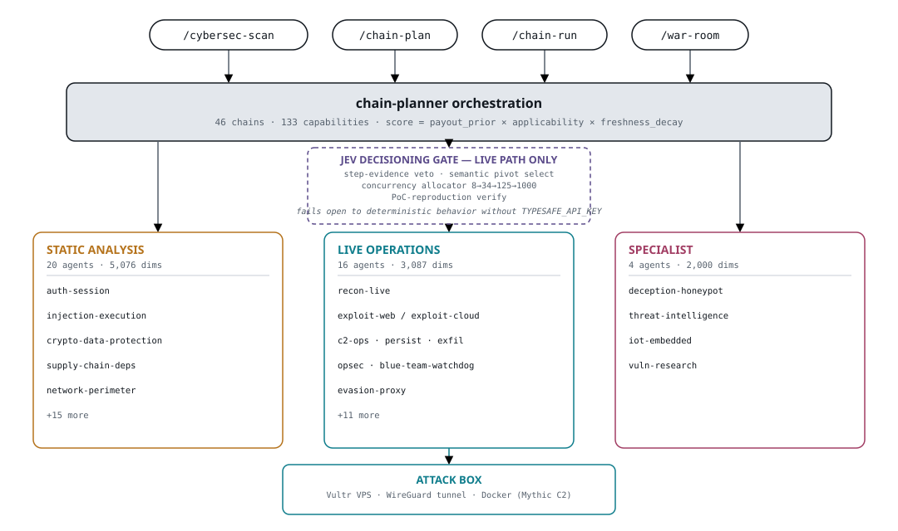

# cybersec-10000 — a 40-agent security analysis swarm

A Claude Code plugin I designed and built: **40 specialized security agents covering ~10,163 security dimensions**, spanning static code/architecture audit and live offensive operations, orchestrated by a scored exploit-chain planner with a judgment layer on the live-operations path. Currently at **v1.4.2**, actively maintained.

> **This repo is a public showcase, not the source.** The plugin source is private and shared on request — contact me on GitHub: [@AIagentPRO78](https://github.com/AIagentPRO78). See [Requesting access](#requesting-access).

## At a glance

| | |
|---|---|
| Version | v1.4.2 — shipped to `main` (merged, not a feature branch) |
| Agents | 40 — 20 static analysis · 16 live operations · 4 specialist |
| Dimensions | ~10,163 — 5,076 static · 3,087 live · 2,000 specialist |
| Exploit chains | 46 named chains across 9 categories |
| Capabilities | 133 reusable capability tags |
| Frameworks mapped | 40+ (OWASP, MITRE ATT&CK/ATLAS, NIST, PCI DSS 4.0, ISO 27001:2022, CIS, …) |
| Tests | 502 passed (`pytest`, chain-planner) |
| License | MIT — source shared on request |

---

## 1. Architecture

Four slash commands (`/cybersec-scan`, `/chain-plan`, `/chain-run`, `/war-room`) feed a `chain-planner` orchestration layer that scores 46 pre-built exploit chains against a target (`payout_prior × applicability × freshness_decay`) and fans out to three agent tiers. Static-analysis agents are read-only and safe to run anywhere; live-operations agents execute exclusively against a dedicated attack box (a Vultr VPS reached over WireGuard), never from the operator's own machine.

### 1.1 Static analysis — 20 agents, 5,076 dimensions

Pre-game code, architecture, and compliance audit. Expanded roster (~2.5× more dimensions/agent than the plugin's predecessor, cybersec-2000):

| Agent | Focus |
|---|---|
| `input-validation-xss` | XSS, CSP, CSRF, file upload, SSRF per cloud provider, header hygiene |
| `injection-execution` | SQLi per DB engine, OS/NoSQL/SSTI/XXE, deserialization, prototype pollution |
| `auth-session` | OAuth/SAML/OIDC per provider, MFA, WebAuthn/FIDO2/passkeys, JWT, session mgmt |
| `authz-access-control` | IDOR, RBAC/ABAC/ReBAC, multi-tenancy, cloud IAM, K8s RBAC, GraphQL authz |
| `crypto-data-protection` | Encryption, KMS per cloud, TLS, PQ readiness, secrets, FIPS 140-3 |
| `api-cloud-security` | OWASP API Top 10, CSA CCM, GraphQL/gRPC/WebSocket, per-AWS-service depth |
| `supply-chain-deps` | CVE/SBOM/SLSA/S2C2F, dep-confusion per ecosystem, CI/CD per platform |
| `architecture-threat-model` | STRIDE/PASTA/LINDDUN/MITRE, serverless/container/edge/multi-cloud threats |
| `compliance-monitoring` | NIST CSF 2.0, PCI DSS 4.0, ISO 27001:2022, HIPAA, SOC 2, GDPR, AI Act |
| `ai-llm-security` | OWASP LLM 2025, MITRE ATLAS, prompt injection, RAG, agent security, multimodal |
| `mobile-app-security` | OWASP Mobile 2024, iOS Keychain/ATS, Android intents, pinning bypass |
| `osint-recon` | Employee enum, breach data, GitHub secret scan, CT mining, Shodan/Censys |
| `red-team-operations` | Adversary emulation (APT29/28/FIN7/Lazarus), Caldera, Atomic Red Team |
| `privacy-data-governance` | GDPR/CCPA/CPRA/LGPD/PIPL, DPIA, consent, retention, transfers |
| `email-security` | SPF/DKIM/DMARC, BEC, gateway bypass, homoglyph, O365/Workspace security |
| `resilience-continuity` | DR/BCP, backup, RTO/RPO, chaos engineering, ransomware resilience |
| `network-protocol-security` | TLS 1.2/1.3 deep, HTTP/2/3, gRPC, WebSocket, MQTT, BGP/OSPF, DoH/DoT |
| `physical-hardware` | HSM, secure boot, side-channel, USB, JTAG/UART, FIPS 140-3, CC EAL |
| `network-perimeter` | Port scan, fingerprint, WAF bypass, CDN, IDS evasion, AWS VPC controls |
| `human-factor` | Insider threat, phishing/vishing/smishing, pretexting, awareness maturity |

### 1.2 Live operations — 16 agents, 3,087 dimensions

Adapted from an earlier "AttackBox War Room" project, expanded. Agent 39 (`blue-team-watchdog`) and 40 (`evasion-proxy`) were added at v1.1.0+ for counter-detection.

| Agent | Focus |
|---|---|
| `recon-live` | Active recon: nmap/masscan/rustscan, httpx, nuclei, subfinder, internal post-compromise discovery |
| `exploit-web` | Live web exploitation: sqlmap, dalfox, ffuf, nuclei, commix, jwt_tool, SSRFmap |
| `exploit-net` | Network/service exploitation: SMB/RDP/SSH/SNMP/WinRM, Impacket, NetExec, Evil-WinRM |
| `exploit-cloud` | AWS IAM priv-esc, S3/Lambda/EC2/RDS/ECS/EKS, Pacu/CloudFox/Prowler |
| `c2-ops` | Sliver/Mythic/Havoc, per-EDR evasion, malleable profiles, DoH/CDN/cloud-storage C2 |
| `cred-ops` | Spray, hashcat/john/hydra, kerbrute, Responder, LSASS, DPAPI, browser creds |
| `persist` | Windows/Linux/macOS/cloud/K8s persistence (25+/20+/10/15/5 methods); stealth + redundancy |
| `exfil` | DNS (dnscat2/iodine), HTTPS, ICMP, stego, cloud upload; flag-capture lifecycle |
| `opsec` | Counter-blue: AMSI bypass, ETW patch, LOLBins, direct syscalls, JA4 rotation |
| `warroom` | Competition meta-orchestrator; phase mgmt, target prio, state, endgame |
| `resource-dev` | Pre-game infra: payload dev, AV/EDR testing, phishing infra, Terraform/Docker |
| `identity-ops` | AD/Azure AD/Entra: BloodHound, ADCS ESC1–13, Golden/Silver/Diamond/Sapphire tickets |
| `wireless` | WPA2/WPA3, 802.1X, evil twin/Karma/MANA, Bluetooth/BLE, NFC/RFID (needs USB monitor-mode adapter) |
| `binexp` | ROP/JOP/SROP, ASLR/NX/PIE/Canary/RELRO/CFI/CET bypass; Ghidra/pwntools |
| `blue-team-watchdog` | Polls GreyNoise/VT/WAF/Cloudflare/Fastly/CloudTrail; auto-pauses chains on detection |
| `evasion-proxy` | JA4/HTTP-2/DoH fingerprint rotation; residential mesh; curl-impersonate; uTLS |

### 1.3 Specialist — 4 agents, 2,000 dimensions

| Agent | Focus |
|---|---|
| `deception-honeypot` | Honeypot detect/avoid, honeytoken analysis, counter-deception, decoy networks |
| `threat-intelligence` | CISA KEV, CVE/EDB/Metasploit correlation, exploit chain construction, patch prediction |
| `iot-embedded` | Firmware extract, MQTT/CoAP/Zigbee/BLE/Modbus/DNP3, JTAG/UART, ICS/OT, IEC 62443 |
| `vuln-research` | 0-day discovery: source audit, fuzzing (AFL++, grammar), patch diffing, race conditions |

### 1.4 Frameworks covered

Every dimension maps to a recognized framework so findings are auditable and report-ready rather than free-form:

| Category | Frameworks |
|---|---|
| OWASP | Top 10 2021, API Top 10 2023, LLM Top 10 2025, Mobile Top 10 2024 |
| MITRE | ATT&CK Enterprise v15, ATT&CK Mobile v15, ATT&CK ICS v15, ATLAS v2, D3FEND v1 |
| CWE / CAPEC | CWE Top 25 2024, CAPEC 3.9, SANS Top 25 |
| NIST | CSF 2.0, SP 800-53 Rev 5, AI 100-2, Privacy Framework 1.0, SP 800-177 (email), SP 800-41 (network) |
| Threat modeling | STRIDE, DREAD, PASTA, LINDDUN, TIARA |
| Compliance | PCI DSS 4.0, ISO 27001:2022, ISO 22301:2019, ISO 27701:2019, HIPAA, SOC 2, GDPR/CCPA/CPRA |
| Cloud | CSA CCM v4, CIS Benchmarks v8 |
| Supply chain | SLSA v1.0, S2C2F |
| Crypto / hardware | FIPS 140-3 |
| Methodology | OSSTMM 3, PTES, RE&CT |
| OT / IoT | IEC 62443, ETSI EN 303 645 |

---

## 2. The chain layer

Chains are reusable multi-step exploit recipes stored as Markdown + YAML frontmatter, one file per chain. Each declares target tech, scope, expected steps (agent + capability tag), success criteria, and a payout prior (historical bounty $). 46 chains across 9 categories:

| Category | Examples |
|---|---|
| ai | langchain-agent-to-rce, soc-copilot-prompt-injection |
| api | GraphQL introspection→IDOR, gRPC reflection abuse, REST mass-assignment chains |
| auth | OAuth implicit/PKCE downgrades, SAML XSW, JWT alg-none, EIP-7702 delegation hijack |
| cloud | IMDSv2 SSRF bypass, ADCS ESC escalation, GuardDuty noise-floor blending |
| crypto | Signature malleability, weak nonces, low-S, deterministic-k reuse |
| defi | Reentrancy, sandwich, price-oracle manipulation, governance flash-loan |
| evasion | Defender XDR ASR-AMSI bypass, Sentinel KQL blindspot mapping, JA4 rotation |
| ml | Huggingface model trojan, Bedrock agent action-group injection |
| web | CORS wildcard credentialed ATO, SSRF metadata→lateral, subdomain takeover, prototype pollution |

133 capability tags (e.g. `cors-misconfig-detect`, `ssrf-probe`, `dep-confusion-scan`) are declared in agent frontmatter and reused inside chain steps, so a chain fires only the dimensions it actually needs instead of running a full agent. Scoring: `score = payout_prior_usd × applicability × freshness_decay`, where applicability matches a chain's declared target tech/misconfig hints against the current target and freshness_decay down-weights chains whose underlying primitive is likely patched at scale.

Workflow: **plan** (`/chain-plan <target> --tech … --top 5` → ranked plan file) → **run** (`/chain-run <chain-id>`, manual go/no-go gate per step, evidence logged) → **promote** (`/chain-promote <chain-id>`, a proven chain rejoins the library) → **sync** (`/chain-sync`, lints the library, idempotent).

---

## 3. Jev (TypeSafe System One) decisioning

The newest piece, and the one I think is the most interesting design decision: a judgment layer wired into the live-operations path only, not the static-analysis path. Four integration points, each a *bounded* judgment (yes/no, pick-one-of-N, graded score) rather than open-ended generation:

| Decision point | Before | With Jev |
|---|---|---|
| Step success (`chain-run` step-evidence veto) | The agent executing a step graded its own work — no independent check. | An independent call judges whether the evidence actually supports "success," and can veto a step before a false success propagates into the next pivot. |
| Pivot selection (`chain-run` semantic pivot) | Pure arithmetic (`payout_prior × applicability × freshness_decay`), blind to what the evidence said. | Reads the accumulated evidence and picks the capability semantically closest to what was just found — something the formula structurally can't do. Always requires manual confirmation before auto-launch. |
| Concurrency priority (`war-room`) | Fixed 8-agent cap, ordered only by static payout priors. | A batched call re-ranks the top-k shortlist by situational relevance before each dispatch wave. |
| Promotion crediting (`chain-promote`) | A payout claim was accepted on trust; priors updated unconditionally. | A pre-check verifies the reproduction-evidence actually supports the claimed success before the historical-payout data updates — stops a bad promotion from polluting future rankings. |

**Why Jev and not another full model call:** every one of the four is bounded, never generative, so it's materially cheaper and faster at the concurrency this plugin targets (a staged allocator scaling 8→34→125→1000 concurrent agents, chunked at 200 candidates/request to stay under the token cap a batch call implies). Reflexes belong on the fast decision path; generation and tool use belong to the subagents actually running the chains.

**Fail-open by design.** If the API key is absent, or a call errors, times out, or comes back malformed/low-confidence, every integration point defers to the exact pre-Jev deterministic behavior, with a distinct logged reason (`deferred:no_api_key`, `deferred:no_response`, `deferred:malformed_response`, `deferred:low_confidence`). Adding this layer can't make a run less reliable than it was before — worst case it's a no-op.

**Honestly-documented gap:** `war-room`'s parallel dispatch calls agents directly rather than through `/chain-run`, so the per-step veto/pivot calls don't apply to chains launched that way yet — only the pre-dispatch shortlist re-rank does. I'd rather ship that caveat in writing than overclaim coverage.

---

## 4. Attack-box tooling

Live-ops agents never touch the network from the operator's machine — every active call goes through a dedicated VPS (Ubuntu 24.04, LXD-containerized by role: recon / web / net / cloud / c2) reached over WireGuard. The install guide documents the full tool inventory with install paths, e.g.:

- **Recon/web hot-path** (`apt`/`go install`): nmap, masscan, sqlmap, nikto, hydra, john, hashcat, gobuster, ffuf, nuclei, dnsrecon, whatweb, wafw00f, chisel.
- **AD/identity** (`pipx`/release binaries): Impacket, NetExec, Responder, Certipy, evil-winrm, BloodHound CE, Coercer, PetitPotam, kerbrute, ldapdomaindump.
- **C2**: Sliver (single binary), Mythic (docker-compose stack — server/postgres/rabbitmq/react UI + per-payload-type containers).
- **Binary exploitation / reverse engineering**: Ghidra, GDB+pwndbg, pwntools, ROPgadget, one_gadget, angr, radare2, AFL++, checksec, seccomp-tools.
- **Known name-drift gotchas documented in the guide**: Impacket scripts are `GetNPUsers.py`/`secretsdump.py` etc., not an `impacket-*` prefix; use `netexec`, not the now end-of-life `crackmapexec`; install `cargo` via `apt` on the VPS, not `rustup` (which fails on a noexec `/tmp` on hardened boxes).

A 10-minute watchdog cron on the operator's machine auto-snapshots the VPS on a health-check failure; a weekly audit script (`vps-audit.sh`) runs a read-only malware/rootkit sweep and tool-currency check over SSH.

---

## 5. Engineering verification

Not just a design doc — verified end-to-end before publishing this showcase:

- **Tests:** `pytest` against the chain-planner's Python package — **502 passed**.
- **Install, tested end-to-end:** packaged the plugin into a self-installing bundle, added it as a local marketplace in an isolated Claude Code config directory, ran `marketplace add` → `install` → `validate`. All succeeded; the installed plugin reports 40 agents / 9 skills, matching what's documented.
- **Cross-platform audit:** every shipped shell script checked for macOS/Linux portability traps (BSD vs GNU `sed`/`date`/`stat`, bash-4-only syntax, Keychain-only secret storage). Found and fixed one real gap — a couple of docs hardcoded a `brew install`-only path for `pandoc`/`typst`; both now also list the Linux install path.
- **Security review, two independent passes:** pattern-based secret/credential scanning (AWS/OpenAI/GitHub/Slack/PEM key patterns), full-text extraction of all 7 reference PDFs (not just skimmed), real-vs-placeholder IP/target/company-name audit, and a packaging-hygiene check (no `.git`, `.venv`, `__pycache__`, or `.DS_Store` in the shipped bundle). Verdict: safe to share externally.

---

## 6. Safety & authorization posture

The static-analysis half only reads code and is safe to run anywhere. The live-ops half can do real damage and is gated accordingly: `INSTALL.md`, `README.md`, and the `/war-room`/`/cybersec-scan` command docs all carry explicit, mandatory in-session authorization-gate language before any active-exploitation phase — authorization is never inferred from a flag being present, it has to be stated. `/war-room` specifically runs the full kill chain (including lateral movement, persistence, and exfil), which many engagement rules of engagement explicitly prohibit, so the docs call that out by name rather than leaving it implicit.

---

## 7. What's in the source (private, on request)

Everything below sits in the private repo, sanitized (no secrets, no real infra hostnames/IPs — everything live-mode is a placeholder):

- Full plugin source: 40 agent definitions, 8 slash commands, 46 exploit chains, the chain-planner scoring/dispatch skill, VPS attack-box management scripts.
- `INSTALL.md` — the tested install flow described in section 5.
- `docs/` — 7 PDF references: an educational guide, a full per-agent dimension catalog (344 pages, generated by parsing the source so the counts can't silently drift from the code), a dimensions-and-execution code reference, the VPS attack-box setup guide (section 4 above, in full), a `/war-room` competition-orchestration guide, a related-project guide (125-agent-cube), and a README.

---

## Requesting access

The source deliberately isn't published here: it ships live offensive tradecraft, so I share it directly with people I talk to rather than leaving an unattended install link. Contact me on GitHub — [@AIagentPRO78](https://github.com/AIagentPRO78) — tell me who you are and what you'd use it for, and I'll share a sanitized build. Happy to walk through any part of the architecture, any specific agent, or the Jev integration in more depth.

---

## Author

**AIagentPRO78** — cybersecurity researcher, white-hat hacker, bug bounty hunter. cybersec-10000 was designed, built, and is actively maintained solo, drawing on offensive security research, multi-platform bug bounty work, and large-scale agentic system design. MIT-licensed.
