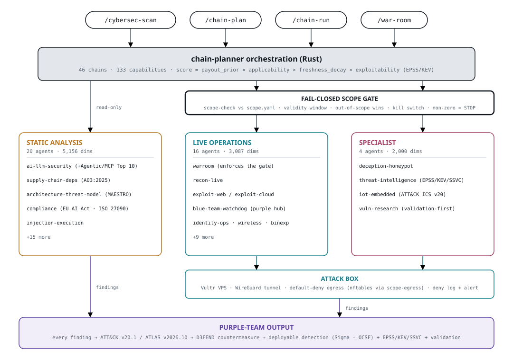

# cybersec-10000 — a 40-agent security analysis swarm

A Claude Code plugin I designed and built: **40 specialized security agents covering ~10,281 security dimensions**, spanning static code/architecture audit and live offensive operations, orchestrated by a scored exploit-chain planner written in Rust. Currently at **v2.2.0**, actively maintained. v2.0 adds a purple-team output (attack → countermeasure → detection), EPSS/KEV-aware scoring, a fail-closed containment model, and re-pins every framework to the 2025–26 editions. v2.1 adds a source-code review of eight open-source offensive AI agent frameworks and turns what it found into ten new audit checks. v2.2 applies the CSA CISO community's "Third Wave" briefing on agentic offensive frameworks: concurrency and rate limits and an OT rule enforced by the scope gate, an engagement record for the client's register of approved tests, and 28 new defensive checks.

> **This repo is a public showcase, not the source.** The plugin source is private and shared on request — contact me on GitHub: [@AIagentPRO78](https://github.com/AIagentPRO78). See [Requesting access](#requesting-access).

## At a glance

| | |
|---|---|
| Version | v2.2.0 |
| Agents | 40 — 20 static analysis · 16 live operations · 4 specialist |
| Dimensions | ~10,281 — 5,184 static · 3,087 live · 2,010 specialist |
| Exploit chains | 47 named chains across 9 categories |
| Capabilities | 136 reusable capability tags |
| Frameworks mapped | 50+, pinned to verified 2025–26 editions (OWASP Top 10:2025 + Agentic/MCP/LLM, ATT&CK v20, ATLAS v2026.10, D3FEND 1.6.0, …) |
| Tests | 198 passed (`cargo test`, Rust chain-planner) · differential test vs the v1.5.2 Python engine: identical output |
| License | MIT — source shared on request |

---

## 1. Architecture

Four slash commands (`/cybersec-scan`, `/chain-plan`, `/chain-run`, `/war-room`) feed a Rust `chain-planner` that scores 47 pre-built exploit chains against a target (`payout_prior × applicability × freshness_decay × exploitability`) and fans out to three agent tiers. Static-analysis agents are read-only and safe to run anywhere. Live-operations and specialist agents pass a fail-closed scope gate before every action and run only on a dedicated attack box (a Vultr VPS reached over WireGuard) whose outbound traffic is default-deny, never from the operator's own machine. Every finding, static or live, carries a purple-team mapping so a defender can act on it.

### 1.1 Static analysis — 20 agents, 5,184 dimensions

Pre-game code, architecture, and compliance audit. Expanded roster (~2.5× more dimensions/agent than the plugin's predecessor, cybersec-2000):

| Agent | Focus |
|---|---|
| `input-validation-xss` | XSS, CSP, CSRF, file upload, SSRF per cloud provider, header hygiene |
| `injection-execution` | SQLi per DB engine, OS/NoSQL/SSTI/XXE, deserialization, prototype pollution |
| `auth-session` | OAuth/SAML/OIDC per provider, MFA, WebAuthn/FIDO2/passkeys, JWT, session mgmt |
| `authz-access-control` | IDOR, RBAC/ABAC/ReBAC, multi-tenancy, cloud IAM, K8s RBAC, GraphQL authz |
| `crypto-data-protection` | Encryption, KMS per cloud, TLS, PQ readiness, secrets, FIPS 140-3 |
| `api-cloud-security` | OWASP API Top 10, CSA CCM, GraphQL/gRPC/WebSocket, per-AWS-service depth |
| `supply-chain-deps` | CVE/SBOM/SLSA/S2C2F, dep-confusion per ecosystem, CI/CD per platform |
| `architecture-threat-model` | STRIDE/PASTA/LINDDUN/MITRE, serverless/container/edge/multi-cloud threats |
| `compliance-monitoring` | NIST CSF 2.0, PCI DSS 4.0, ISO 27001:2022, HIPAA, SOC 2, GDPR, AI Act |
| `ai-llm-security` | OWASP LLM 2025, MITRE ATLAS, prompt injection, RAG, agent security, multimodal |
| `mobile-app-security` | OWASP Mobile 2024, iOS Keychain/ATS, Android intents, pinning bypass |
| `osint-recon` | Employee enum, breach data, GitHub secret scan, CT mining, Shodan/Censys |
| `red-team-operations` | Adversary emulation (APT29/28/FIN7/Lazarus), Caldera, Atomic Red Team |
| `privacy-data-governance` | GDPR/CCPA/CPRA/LGPD/PIPL, DPIA, consent, retention, transfers |
| `email-security` | SPF/DKIM/DMARC, BEC, gateway bypass, homoglyph, O365/Workspace security |
| `resilience-continuity` | DR/BCP, backup, RTO/RPO, chaos engineering, ransomware resilience |
| `network-protocol-security` | TLS 1.2/1.3 deep, HTTP/2/3, gRPC, WebSocket, MQTT, BGP/OSPF, DoH/DoT |
| `physical-hardware` | HSM, secure boot, side-channel, USB, JTAG/UART, FIPS 140-3, CC EAL |
| `network-perimeter` | Port scan, fingerprint, WAF bypass, CDN, IDS evasion, AWS VPC controls |
| `human-factor` | Insider threat, phishing/vishing/smishing, pretexting, awareness maturity |

### 1.2 Live operations — 16 agents, 3,087 dimensions

Adapted from an earlier "AttackBox War Room" project, expanded. Agent 39 (`blue-team-watchdog`) and 40 (`evasion-proxy`) were added at v1.1.0+ for counter-detection.

| Agent | Focus |
|---|---|
| `recon-live` | Active recon: nmap/masscan/rustscan, httpx, nuclei, subfinder, internal post-compromise discovery |
| `exploit-web` | Live web exploitation: sqlmap, dalfox, ffuf, nuclei, commix, jwt_tool, SSRFmap |
| `exploit-net` | Network/service exploitation: SMB/RDP/SSH/SNMP/WinRM, Impacket, NetExec, Evil-WinRM |
| `exploit-cloud` | AWS IAM priv-esc, S3/Lambda/EC2/RDS/ECS/EKS, Pacu/CloudFox/Prowler |
| `c2-ops` | Sliver/Mythic/Havoc, per-EDR evasion, malleable profiles, DoH/CDN/cloud-storage C2 |
| `cred-ops` | Spray, hashcat/john/hydra, kerbrute, Responder, LSASS, DPAPI, browser creds |
| `persist` | Windows/Linux/macOS/cloud/K8s persistence (25+/20+/10/15/5 methods); stealth + redundancy |
| `exfil` | DNS (dnscat2/iodine), HTTPS, ICMP, stego, cloud upload; flag-capture lifecycle |
| `opsec` | Counter-blue: AMSI bypass, ETW patch, LOLBins, direct syscalls, JA4 rotation |
| `warroom` | Competition meta-orchestrator; phase mgmt, target prio, state, endgame |
| `resource-dev` | Pre-game infra: payload dev, AV/EDR testing, phishing infra, Terraform/Docker |
| `identity-ops` | AD/Azure AD/Entra: BloodHound, ADCS ESC1–13, Golden/Silver/Diamond/Sapphire tickets |
| `wireless` | WPA2/WPA3, 802.1X, evil twin/Karma/MANA, Bluetooth/BLE, NFC/RFID (needs USB monitor-mode adapter) |
| `binexp` | ROP/JOP/SROP, ASLR/NX/PIE/Canary/RELRO/CFI/CET bypass; Ghidra/pwntools |
| `blue-team-watchdog` | Polls GreyNoise/VT/WAF/Cloudflare/Fastly/CloudTrail; auto-pauses chains on detection |
| `evasion-proxy` | JA4/HTTP-2/DoH fingerprint rotation; residential mesh; curl-impersonate; uTLS |

### 1.3 Specialist — 4 agents, 2,010 dimensions

| Agent | Focus |
|---|---|
| `deception-honeypot` | Honeypot detect/avoid, honeytoken analysis, counter-deception, decoy networks |
| `threat-intelligence` | CISA KEV, CVE/EDB/Metasploit correlation, exploit chain construction, patch prediction |
| `iot-embedded` | Firmware extract, MQTT/CoAP/Zigbee/BLE/Modbus/DNP3, JTAG/UART, ICS/OT, IEC 62443 |
| `vuln-research` | 0-day discovery: source audit, fuzzing (AFL++, grammar), patch diffing, race conditions |

### 1.4 Frameworks covered

Every dimension maps to a recognized framework, so findings are auditable and report-ready rather than free-form. In v2.0 every version was re-checked against its publisher. The plugin ships a framework canon that lists the verified IDs, and agents may cite only those or IDs confirmed at the pinned version. All 575 ATT&CK, ATLAS and D3FEND IDs the v2.0 agents cite were machine-checked against MITRE's official data (ATT&CK v20.1, ATLAS v2026.10, D3FEND 1.6.0).

| Category | Frameworks |
|---|---|
| OWASP | Top 10:2025, API Security Top 10:2023, Mobile Top 10 2024, Top 10 for LLM Applications 2026, **Top 10 for Agentic Applications 2026**, **MCP Top 10 2025 (beta)** |
| MITRE | ATT&CK Enterprise v20 (incl. the new AI techniques: direct/indirect prompt injection, AI-enabled exfiltration, AI result poisoning), ATLAS v2026.10, D3FEND 1.6.0, CAPEC 3.9, CTID Secure AI v2 |
| CWE | CWE Top 25 2025, SANS Top 25 |
| AI security & governance | **CSA MAESTRO 1.0**, CSA AI Controls Matrix v1.1, CSA Agentic AI Red Teaming Guide 1.0, Google SAIF, Databricks DASF 3.0, NIST AI 600-1, NIST AI 100-2 E2025, NIST COSIS (pre-draft), ISO/IEC 27090:2026, EU AI Act (as amended 2026), EN 18286:2026 |
| Prioritization | EPSS v5, CISA KEV, CVSS v4.0, CISA SSVC |
| NIST | CSF 2.0, SP 800-53 Rev 5, Privacy Framework 1.0, SP 800-177 (email), SP 800-41 (network) |
| Threat modeling | STRIDE, DREAD, PASTA, LINDDUN, TIARA, MAESTRO |
| Compliance | PCI DSS v4.0.1, ISO 27001:2022, ISO 22301:2019, ISO 27701:2019, HIPAA, SOC 2, GDPR/CCPA/CPRA |
| Cloud | CSA CCM v4, CIS Benchmarks v8 |
| Supply chain | SLSA v1.2, S2C2F |
| Crypto / hardware | FIPS 140-3 |
| Methodology | OSSTMM 3, PTES, RE&CT |
| OT / IoT | ATT&CK ICS v20, IEC 62443, ETSI EN 303 645 |

### 1.5 What v2.1 adds: a source review of eight offensive AI agent frameworks

I read the public source of ARTEX, CyberStrikeAI, PentAGI, AutoCVE, RedAmon, Cairn, Strix and HexStrike AI, each at a named commit, to see how they differ and where their controls live. Nothing was built or run.

| Finding | Detail |
|---|---|
| No target allowlist by default | None of the eight enforces one. Six keep scope in the prompt or nowhere; two have code gates that are opt-in or partial |
| Approval gates ship switched off | In four of the eight. One requires human approval before exploitation by default |
| Network-reachable command execution | Two expose it with no authentication in their shipped deployment |
| Orchestrators holding the Docker socket | Three, so a tool-execution flaw there is host control |

What went into the plugin: a canon section recording each claim with its repo and commit, ten new static audit checks for agent frameworks and agent consoles (unauthenticated API, shell construction from model output, prompt-only scope, approval gates that are off or reviewed by a model, and six more), three capabilities and one chain that stops at proof of unauthenticated access, defender-facing fingerprints, and five design proposals for the war-room. The review is a snapshot; these projects change weekly.

### 1.6 What v2.2 adds: lessons from the CSA "Third Wave" briefing

The CSA CISO community's draft briefing on agentic offensive frameworks (v0.8, 24 November 2026) reports what worked and what failed when organizations faced these tools. A plugin like this one is such a framework run under authorization, so the briefing's advice to testers applies to it directly.

| Briefing lesson | What changed in the plugin |
|---|---|
| Bound automated actions with enforceable limits | The scope file can set a concurrency limit and a request rate. The gate denies a dispatch over the limit, and the attack box's firewall rules enforce the rate |
| Test OT only against a range or a replica | A new `--ot` check allows OT actions only for targets the scope file declares as a range or replica |
| Keep a register of approved tests | A new `engagement-record` command prints a record for the client's SOC. The tool never plants "this is authorized" markers on a target |
| Detection tied to one tool goes stale | Tool-agnostic behavioural detections were added, and the v2.1 fingerprints are labelled as lagging indicators |
| Deception slowed or stopped attackers | Ten checks for AI-aware deception: canary keys, decoy accounts, and content aimed at an attacking model |
| Partial cleanup failed | Twelve readiness checks and an optional report section on complete remediation |
| A fork shipped a backdoored container image | The attack-box audit flags images that are not pinned by digest |

Two independent reviewers checked the release before it shipped. One tried to make the gate fail open with about 60 adversarial scope files and 925 comparisons against the previous build, and found no way. The other found that a parallel wave could exceed the new concurrency limit and that the watchdog was not counted; both were fixed. The new firewall rate-limit rule was then validated on nftables 1.1.6 in a Fedora CoreOS Podman machine, which showed it needed an explicit burst size; that is fixed too.

---

## 2. The chain layer

Chains are reusable multi-step exploit recipes stored as Markdown + YAML frontmatter, one file per chain. Each declares target tech, scope, expected steps (agent + capability tag), success criteria, and a payout prior (historical bounty $). 47 chains across 9 categories:

| Category | Examples |
|---|---|
| ai | langchain-agent-to-rce, soc-copilot-prompt-injection, exposed-agent-console-to-host-exec |
| api | graphql-idor-via-aliases, mass-assignment-privesc, batch-idor, rate-limit-bypass-to-enum |
| auth | oauth-open-redirect-token-theft, saml-assertion-replay, mfa-bypass-via-recovery, adcs-esc-escalation |
| cloud | imdsv2-ssrf-bypass-2026, guardduty-noise-floor-blending, bedrock-agent-action-group-injection, s3-bucket-takeover |
| crypto | ecdsa-nonce-reuse, padding-oracle-to-session, weak-jwt-secret-brute, hash-length-extension |
| defi | eip-7702-delegation-hijack |
| evasion | defender-xdr-asr-amsi-bypass-2026, sentinel-kql-blindspot-mapping, ja4-rotation-active-probe |
| ml | huggingface-model-trojan |
| web | cors-wildcard-credentialed-ato, ssrf-to-iam-takeover, subdomain-takeover-to-cookie-scope, prototype-pollution-rce |

136 capability tags (e.g. `cors-wildcard-credentialed`, `ssrf-basic-detection`, `supply-chain-dep-confusion`) are declared in agent frontmatter and reused inside chain steps, so a chain fires only the dimensions it actually needs instead of running a full agent. Scoring: `score = payout_prior_usd × applicability × freshness_decay × exploitability`. Applicability matches a chain's declared target tech and misconfig hints against the current target. Freshness_decay down-weights chains that haven't produced a paid finding recently. Exploitability (new in v2.0) is neutral (1.0) unless you supply CVE intel: then it is 1.5 for a CISA KEV-listed CVE, or `0.5 + EPSS` otherwise, so chains built on bugs being exploited in the wild rise to the top.

Workflow: **plan** (`/chain-plan <target> --tech … --top 5` → ranked plan file) → **run** (`/chain-run <chain-id>`, manual go/no-go gate per step, evidence logged) → **promote** (`/chain-promote`, records a paid finding so that chain ranks higher in future plans) → **sync** (`/chain-sync`, lints the library, idempotent).

---

## 3. Attack-box tooling

Live-ops agents never touch the network from the operator's machine — every active call goes through a dedicated VPS (Ubuntu 24.04, LXD-containerized by role: recon / web / net / cloud / c2) reached over WireGuard. The install guide documents the full tool inventory with install paths, e.g.:

- **Recon/web hot-path** (`apt`/`go install`): nmap, masscan, sqlmap, nikto, hydra, john, hashcat, gobuster, ffuf, nuclei, dnsrecon, whatweb, wafw00f, chisel.
- **AD/identity** (`pipx`/release binaries): Impacket, NetExec, Responder, Certipy, evil-winrm, BloodHound CE, Coercer, PetitPotam, kerbrute, ldapdomaindump.
- **C2**: Sliver (single binary), Mythic (docker-compose stack — server/postgres/rabbitmq/react UI + per-payload-type containers).
- **Binary exploitation / reverse engineering**: Ghidra, GDB+pwndbg, pwntools, ROPgadget, one_gadget, angr, radare2, AFL++, checksec, seccomp-tools.
- **Known name-drift gotchas documented in the guide**: Impacket scripts are `GetNPUsers.py`/`secretsdump.py` etc., not an `impacket-*` prefix; use `netexec`, not the now end-of-life `crackmapexec`; install `cargo` via `apt` on the VPS, not `rustup` (which fails on a noexec `/tmp` on hardened boxes).

A 10-minute watchdog cron on the operator's machine auto-snapshots the VPS on a health-check failure; a weekly audit script (`vps-audit.sh`) runs a read-only malware/rootkit sweep and tool-currency check over SSH.

---

## 4. Engineering verification

Not just a design doc — verified end-to-end before publishing this showcase:

- **Tests:** `cargo test` against the Rust chain-planner: **198 passed**, and `cargo clippy -D warnings` is clean. Before the Python engine was removed, a differential test ran lint, sync, score and promote through both engines over the full chain library and edge cases. The JSON output and exit codes were identical.
- **Adversarial review of the scope gate:** a reviewer tried to make `scope-check` allow what it shouldn't and found seven real issues: an IPv4-mapped IPv6 out-of-scope bypass, split allow-all CIDRs, nftables injection through a file path, public-suffix domain rules and three smaller parsing issues. All seven are fixed with regression tests.
- **Framework IDs:** all 575 ATT&CK, ATLAS and D3FEND IDs the v2.0 agents cite were machine-checked against MITRE's official data. Revoked IDs were remapped through ATT&CK's own revoked-by relationships.
- **Install, tested end-to-end (v1.5.1; not yet repeated for v2.0):** packaged the plugin into a self-installing bundle, added it as a local marketplace in an isolated Claude Code config directory, ran `marketplace add` → `install` → `validate`. All succeeded; the installed plugin reports 40 agents and 9 skills/commands (the 8 slash commands plus the chain-planner skill), matching what's documented.
- **Cross-platform audit:** every shipped shell script checked for macOS/Linux portability traps (BSD vs GNU `sed`/`date`/`stat`, bash-4-only syntax, Keychain-only secret storage). Found and fixed one real gap — a couple of docs hardcoded a `brew install`-only path for `pandoc`/`typst`; both now also list the Linux install path.
- **Security review, two independent passes:** pattern-based secret/credential scanning (AWS/OpenAI/GitHub/Slack/PEM key patterns), full-text extraction of all 7 reference PDFs (not just skimmed), real-vs-placeholder IP/target/company-name audit, and a packaging-hygiene check (no `.git`, `.venv`, `__pycache__`, or `.DS_Store` in the shipped bundle). Verdict: safe to share externally.

---

## 5. Safety, containment & authorization

The static-analysis half only reads code and is safe to run anywhere. The live-ops half can do real damage, so v2.0 moves containment out of the agents' instructions and into controls they can't talk their way past:

- **Fail-closed scope gate.** Live runs require a machine-readable `scope.yaml` (engagement id, authorization reference, validity window, in-scope and out-of-scope hosts, domains and CIDRs). Before every action against a host, the commands run `chain-planner scope-check`. Any non-zero exit means stop: a missing or invalid file, an expired window, an out-of-scope target, or an engaged kill switch. Out-of-scope rules win, and newly discovered hosts stay out of scope until a human edits the file.
- **Network-layer egress control.** `chain-planner scope-egress` renders a default-deny nftables policy for the attack box that allows only the engagement's allowlist and logs every denied outbound connection. It is enforced by the kernel, not by anything an agent can reconfigure.
- **Limits and an OT rule in the gate (v2.2).** The scope file can cap concurrent agents and the outbound request rate, and can declare OT targets as a range or replica. The gate denies anything over the cap and any OT action against an undeclared target.
- **Kill switch.** `touch ~/.cybersec-10000/KILL` halts every new dispatch immediately.
- **Human authorization still required.** `/war-room` and `/cybersec-scan --live` still stop and require the operator to affirm, in-session, that the target is in an authorized engagement scope. The scope file adds to that affirmation and never replaces it.

The design follows the Cloud Security Alliance's 2026 guidance on containing autonomous offensive tools, written after an AI red-team agent escaped its sandbox and exfiltrated real customer data: default-deny egress outside the agent's control, a machine-readable scope checked before every action, no automatic scope expansion, and a documented human kill switch.

**Known gaps in v2.0.** The automated upgrade was run with Opus 5.5, and its safety safeguards stopped the edits to `/war-room` and to ten of the offensive live-ops agent definitions (c2-ops, cred-ops, evasion-proxy, exfil, exploit-cloud, exploit-net, identity-ops, opsec, persist, resource-dev). Those files are unchanged from v1.5.2. They don't carry the new Containment section or the purple-team finding fields, and `/war-room` doesn't yet call the scope gate itself. Agents also still SSH to the attack box as root, so egress control there is an enforced rule rather than a technical barrier until they move to a non-root user.

---

## 6. What's shared on request

The sanitized build (no secrets, no real infra hostnames/IPs — everything live-mode is a placeholder) contains the plugin source from the private repo, plus an install guide and reference PDFs that are packaged with the build rather than kept in the source repo:

- Full plugin source: 40 agent definitions, 8 slash commands, 47 exploit chains, the chain-planner scoring/dispatch skill, VPS attack-box management scripts.
- `INSTALL.md` — the tested install flow described in section 4.
- `docs/` — 7 PDF references: an educational guide, a full per-agent dimension catalog (344 pages, generated by parsing the source so the counts can't silently drift from the code), a dimensions-and-execution code reference, the VPS attack-box setup guide (section 3 above, in full), a `/war-room` competition-orchestration guide, a related-project guide (125-agent-cube), and a README.

---

## Requesting access

The source deliberately isn't published here: it ships live offensive tradecraft, so I share it directly with people I talk to rather than leaving an unattended install link. Contact me on GitHub — [@AIagentPRO78](https://github.com/AIagentPRO78) — tell me who you are and what you'd use it for, and I'll share a sanitized build. Happy to walk through any part of the architecture or any specific agent, in more depth.

---

## Author

**AIagentPRO78** — cybersecurity researcher, white-hat hacker, bug bounty hunter. cybersec-10000 was designed, built, and is actively maintained solo, drawing on offensive security research, multi-platform bug bounty work, and large-scale agentic system design. MIT-licensed.
